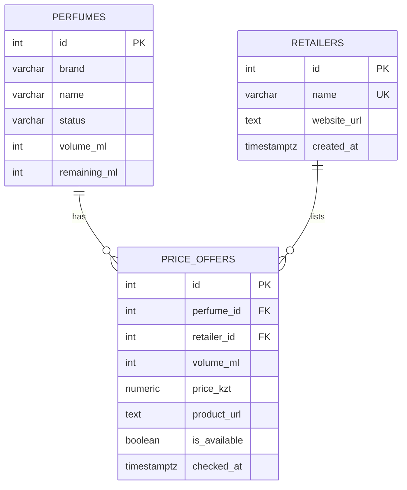

# Perfume Price Tracker — Flask REST API

**Web Application Development | Homework 4**

A backend application for managing a personal perfume collection, registering perfume retailers, and comparing bottle prices across stores. Built with **Flask + PostgreSQL + Docker Compose**, with a complete Postman collection for API testing.

> **Scope:** This submission covers the required relational database and REST API. Automatic price retrieval from websites and a decant/profit calculator are **future enhancements**, not included in this version.

## Features

- Manage perfumes (`owned`, `wishlist`, `want_to_test`) with full CRUD and optional filters.
- Manage retailers (shop name and website URL) with full CRUD.
- Manage price offers (perfume, retailer, bottle volume, price in KZT, product URL, availability) with full CRUD.
- List price offers for a particular perfume or retailer using SQL `JOIN`.
- Find the **cheapest available offer for the requested bottle size**, not just the lowest total price across different sizes.
- Enforce foreign keys, uniqueness, check constraints, JSON validation, and appropriate HTTP status codes.
- Persist PostgreSQL data in a Docker named volume.

## Technology

| Layer | Technology |
|---|---|
| API | Python 3.12, Flask |
| Database access | psycopg2, `RealDictCursor`, parameterized SQL |
| Database | PostgreSQL 17 |
| Containers | Docker, Docker Compose |
| Testing | Postman collection v2.1 |
| Format | JSON over HTTP; backend only |

## Architecture and relationships



**Three entities, two one-to-many relationships:**

1. One perfume can have many price offers (`perfumes.id → price_offers.perfume_id`).
2. One retailer can list many price offers (`retailers.id → price_offers.retailer_id`).

The existing perfume table is named **`postgres_sabog_table`** (retained from the earlier project). The two added tables are `retailers` and `price_offers`.

**Database constraints:**

- `price_offers.perfume_id` references the perfume table with `ON DELETE CASCADE` — deleting a perfume deletes its associated offers.
- `price_offers.retailer_id` references `retailers` with `ON DELETE RESTRICT` — retailers with offers cannot be deleted.
- `(perfume_id, retailer_id, volume_ml)` is unique — one current offer per perfume, retailer, and bottle size.
- Bottle volume and offer price must be positive; retailer names must be unique.

## Project structure

```text
perfume-price-tracker/
├── app.py
├── db.py
├── Dockerfile
├── compose.yaml
├── requirements.txt
├── .env.example
├── .gitignore
├── .dockerignore
├── README.md
├── API_DOCUMENTATION.md
└── postman/
    └── Perfume_Price_Tracker.postman_collection.json
```

## Setup and run

**Prerequisite:** Docker Desktop with Docker Compose.

1. Clone the repository and enter the project directory:
   ```bash
   git clone <YOUR_REPOSITORY_URL>
   cd perfume-price-tracker
   ```
2. Create your local environment file:
   ```bash
   cp .env.example .env
   ```
   Update `.env` with values for `POSTGRES_DB`, `POSTGRES_USER`, and `POSTGRES_PASSWORD`. Keep the file local; **never commit credentials**.
3. Start the backend and PostgreSQL:
   ```bash
   docker compose up -d --build
   ```
4. Verify that the server responds:
   ```bash
   curl http://localhost:5051/api/health
   ```
   Expected: `{"project":"My Perfume Collection","status":"ok"}` (JSON key order may differ).
5. Stop the services when finished:
   ```bash
   docker compose down
   ```

**Persistence:** PostgreSQL stores data in the named Docker volume `perfume_data`. `docker compose down` preserves data; **do not run `docker compose down -v` if you need the existing records**.

The backend is exposed at **`http://localhost:5051`**. Inside the Docker network, Flask accesses PostgreSQL using the service name **`sabog_docker_db`** and database credentials from `.env`. `init_db()` uses `CREATE TABLE IF NOT EXISTS`, so normal restarts do not replace existing data.

### Verify database tables (optional)

```bash
docker compose exec sabog_docker_db psql -U perfume_user -d <POSTGRES_DB_VALUE>
```

Then run `\dt` and verify `postgres_sabog_table`, `retailers`, `price_offers`. Substitute your actual `POSTGRES_DB` value from `.env` for `<POSTGRES_DB_VALUE>`.

## API overview — 19 distinct method/path endpoints

**Base URL:** `http://localhost:5051`  
**POST/PUT content type:** `application/json`

### Health and perfumes (6)

| Method | Endpoint | Purpose |
|---|---|---|
| GET | `/api/health` | Health response |
| GET | `/api/perfumes` | List perfumes; optional `status`, `low_stock` filters |
| GET | `/api/perfumes/<id>` | Get one perfume |
| POST | `/api/perfumes` | Create a perfume |
| PUT | `/api/perfumes/<id>` | Replace perfume editable fields |
| DELETE | `/api/perfumes/<id>` | Delete a perfume (and its offers) |

### Retailers (5)

| Method | Endpoint | Purpose |
|---|---|---|
| GET | `/api/retailers` | List retailers |
| GET | `/api/retailers/<id>` | Get one retailer |
| POST | `/api/retailers` | Create a retailer |
| PUT | `/api/retailers/<id>` | Replace retailer name and URL |
| DELETE | `/api/retailers/<id>` | Delete retailer if no offers refer to it |

### Price offers (5)

| Method | Endpoint | Purpose |
|---|---|---|
| GET | `/api/price-offers` | List offers |
| GET | `/api/price-offers/<id>` | Get one offer |
| POST | `/api/price-offers` | Create an offer |
| PUT | `/api/price-offers/<id>` | Replace an offer; update `checked_at` |
| DELETE | `/api/price-offers/<id>` | Delete an offer |

### Related endpoints (3)

| Method | Endpoint | Purpose |
|---|---|---|
| GET | `/api/perfumes/<id>/offers` | Offers for one perfume, joined with retailer details |
| GET | `/api/retailers/<id>/offers` | Offers from one retailer, joined with perfume details |
| GET | `/api/perfumes/<id>/cheapest?volume_ml=100` | Lowest **available** price for this exact size; defaults to the perfume's `volume_ml` |

**Total: 6 + 5 + 5 + 3 = 19 endpoints.** See [API_DOCUMENTATION.md](API_DOCUMENTATION.md) for request bodies, validation, response examples, and error codes.

## Key behavior and examples

### Perfume statuses and low-stock filter

Allowed statuses are `owned`, `wishlist`, and `want_to_test`.

```http
GET /api/perfumes?status=owned
GET /api/perfumes?low_stock=true
GET /api/perfumes?status=wishlist
```

The initial perfume implementation has a `low_stock` threshold in `app.py` (**30 ml in the verified original code**). The filter applies only to `owned` perfumes. If the local implementation was modified, its actual threshold is determined by the value passed in that query.

### Example price offer

```http
POST /api/price-offers
Content-Type: application/json
```

```json
{
  "perfume_id": 1,
  "retailer_id": 1,
  "volume_ml": 100,
  "price_kzt": 168000,
  "product_url": "https://goldapple.kz/82401500003-musc-ravageur",
  "is_available": true
}
```

IDs `1` and the price are examples; use existing perfume and retailer IDs in your own database. Price offers are entered **manually** in this submission; a new POST is not a live price lookup.

### Cheapest offer

```http
GET /api/perfumes/1/cheapest?volume_ml=100
```

The query filters to the exact volume and `is_available = true`, sorts by `price_kzt ASC`, and returns a single cheapest offer. A 30 ml offer never competes with a 100 ml offer. When `volume_ml` is omitted, the perfume's stored `volume_ml` is used.

## Postman: import and demonstrate

Import **[`postman/Perfume_Price_Tracker.postman_collection.json`](postman/Perfume_Price_Tracker.postman_collection.json)** in Postman.

The collection contains **31 saved requests**, organized as a safe end-to-end demonstration. It uses collection variables:

| Variable | Default | Role |
|---|---|---|
| `baseUrl` | `http://localhost:5051` | Local API |
| `testPerfumeId` | empty | Populated by test perfume POST |
| `testRetailerId` | empty | Populated by test retailer POST |
| `testOfferId` | empty | Populated by test price-offer POST |

**Recommended order:** `01 Health` → `02 Create Test Data` → `03 Perfumes` → `04 Retailers` → `05 Price Offers` → `06 Related` → `07 Negative Tests` → `08 Cleanup`.

Creating test data first avoids relying on hard-coded production IDs; cleanup **deletes only the temporary test records** and does so in reverse dependency order: offer → retailer → perfume. The POST requests automatically save their new IDs in collection variables. Negative tests cover `400`, `404`, and `409` without intentionally modifying existing real data.

You can run the individual requests in this order or run the whole collection in the Postman Collection Runner. If a test setup request fails, do **not** run cleanup until its IDs are confirmed.

## Validation and HTTP responses

| Status | Meaning |
|---|---|
| `200 OK` | Successful GET, PUT, DELETE |
| `201 Created` | Successful POST |
| `400 Bad Request` | Invalid JSON, fields, or references |
| `404 Not Found` | Requested ID or matching available offer not found |
| `409 Conflict` | Duplicate retailer/offer or restricted retailer deletion |

- SQL queries use parameter placeholders (`%s`) to protect query structure from untrusted values.
- `PUT` is a complete update: send all required fields, including `brand`, `name`, `status` for perfumes, both fields for retailers, and all required offer fields.
- `price_kzt` is backed by PostgreSQL `NUMERIC(12,2)` for decimal monetary values; JSON output may represent it as a string.
- `checked_at` currently reflects when a record was created or edited, **not** proof of an automated check on the retailer's website.

## Planned enhancements (not part of HW4 core)

- Automated, permitted price retrieval for selected retailers using a browser automation tool.
- Local purchase cost, cost per ml, and decant-pricing calculator.
- Packaging cost, markup, and profit estimates.
- Price-change history and stale-price tracking.

## Security and coursework notes

- No credentials are stored in the repository; `.env` and `.venv/` should be ignored by Git.
- The Flask development server is for coursework/demonstration, not production deployment.
- Existing perfume data stays intact during ordinary Docker rebuilds.
